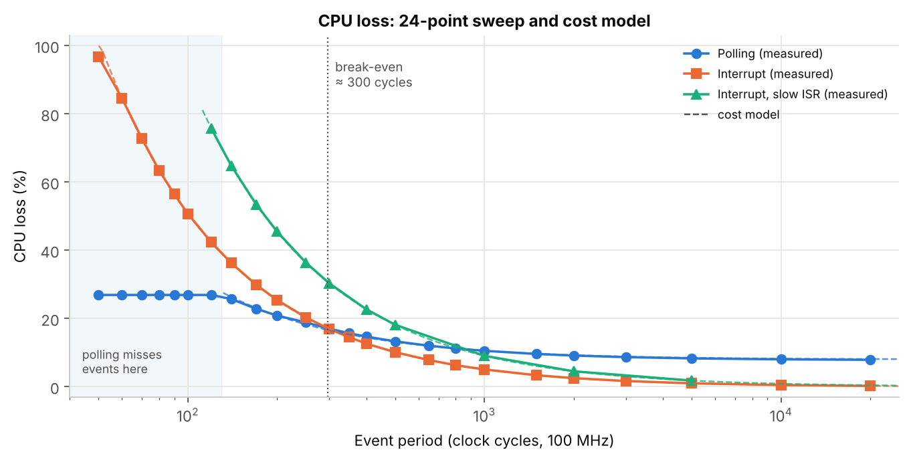
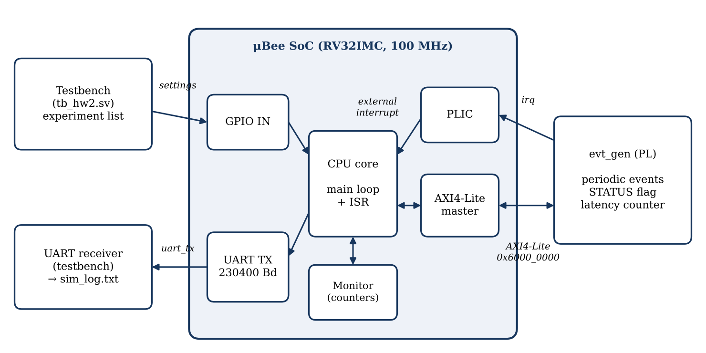
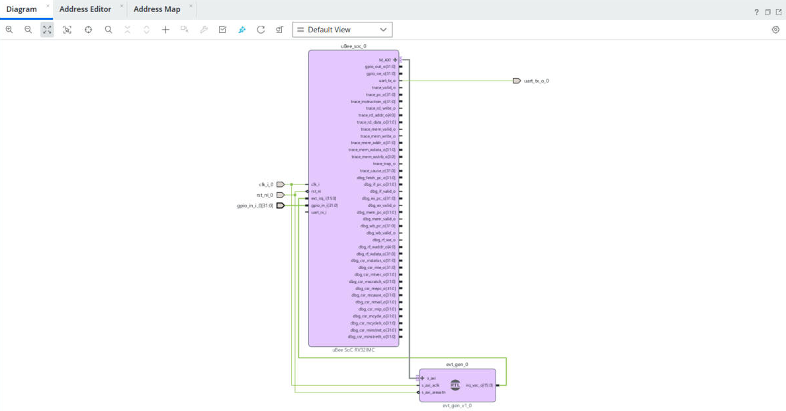
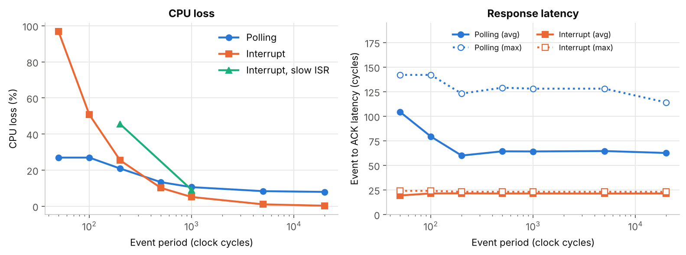
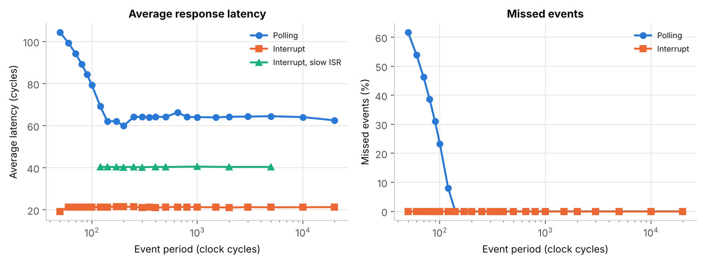
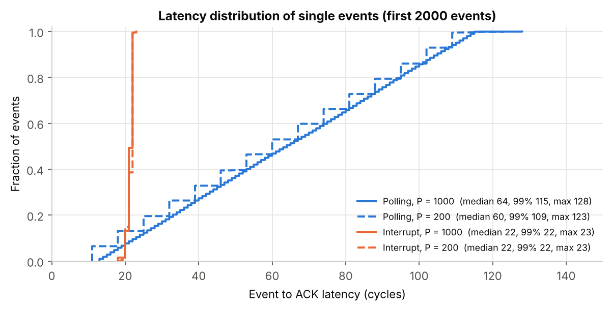
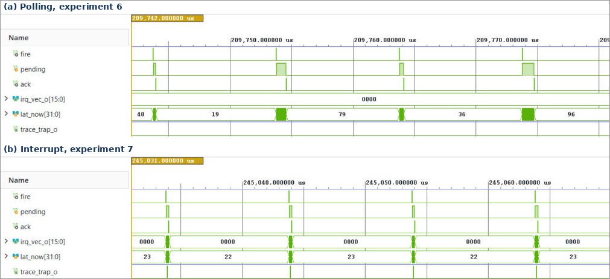
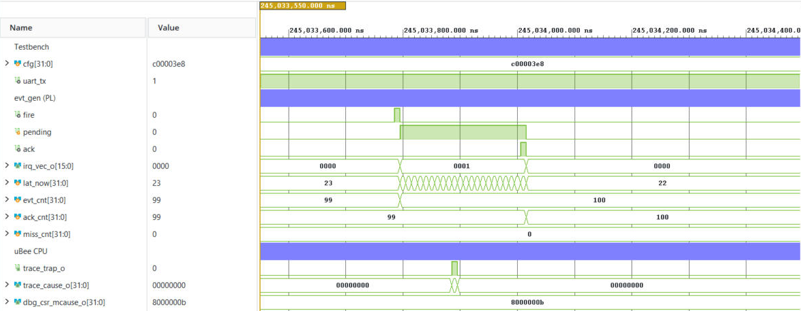
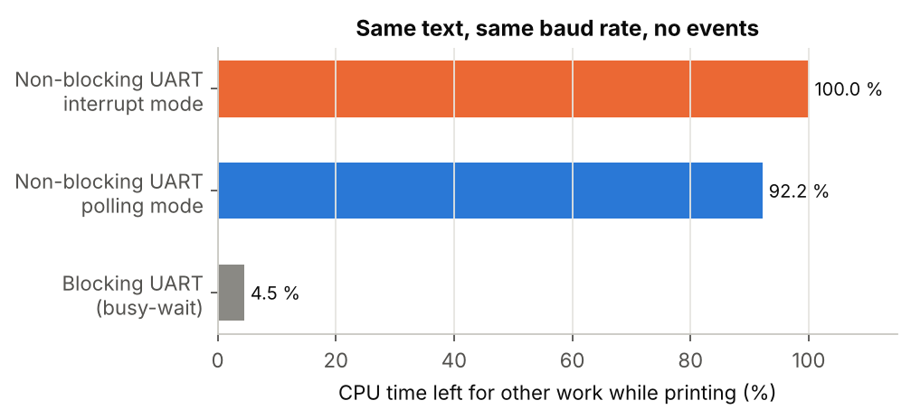

# Interrupt vs. Polling on the microBee RISC-V SoC

**How the event handling method changes the performance of a UART application, measured with the microBee performance counters.**

[](https://github.com/usarrahim/ubee-interrupt-vs-polling/actions/workflows/reproduce.yml)

The microBee (uBee, RV32IMC) prints the opening of *A Tale of Two Cities* over its UART at 230400 baud.
At the same time, a small event generator on the PL side raises periodic events. The **same event** is
handled once with **polling** and once with an **interrupt** (PLIC), with the same program, the same UART
setting, the same text and the same event sequence. CPU cycle loss, response latency, missed events and
total application time are measured from 5 kHz to 2 MHz event rates.

This was my individual project for **EHB326E (Istanbul Technical University, Fall 2026), Homework 2,
topic 8: "Interrupt Performance Effect on UART"**. It is built on the course platform
[**GSTL-ITU/uBee**](https://github.com/GSTL-ITU/uBee) (uBee SoC IP, rv32 assembler/emulator, course book).
After the homework I added an open-source Verilator flow, a 62-point sweep, per-event latency
distributions and a fitted cost model.



## Highlights

- **Break-even at about 300 cycles.** Interrupts cost less CPU when events are slower than one per ~300 cycles
  (about 330 kHz at 100 MHz). Polling costs less for faster events, but it starts to **miss events** below 130 cycles.
- **Latency.** Interrupt: **18 to 24 cycles** for every event. Polling: spread almost uniformly over one loop,
  **11 to 142 cycles**.
- **Cost model** (all fits R² ≥ 0.997). Interrupt **50.8 cycles/event**. Polling **7.8 % fixed** (STATUS reads over
  AXI) **+ 25.7 cycles/event**. ISR with register save/restore **90.9 cycles/event**, so the uBee shadow register
  bank saves 44 %.
- **UART waiting.** Same text, same baud rate: a blocking `putc` loop leaves only **4.5 %** of the CPU for other work;
  the non-blocking loop used here leaves **100 %**.
- **Reproducible.** Vivado XSim (37 min) and Verilator (54 s) give **identical counters in all 19 experiments**.
  CI repeats this on every push with the latest uBee from GitHub.

## Contents

1. [System](#1-system)
2. [Firmware](#2-firmware)
3. [Measurement method](#3-measurement-method)
4. [Results](#4-results)
5. [Verification](#5-verification)
6. [How to reproduce](#6-how-to-reproduce)
7. [Repository layout](#7-repository-layout)
8. [References and acknowledgements](#8-references-and-acknowledgements)

## 1. System

<p align="center"></p>

The Vivado block design `hw2_system` has two blocks: the **uBee SoC IP** (`uBee_soc_0`, from GSTL-ITU/uBee)
and my module **`evt_gen`** (`hw/evt_gen.v`). `evt_gen` is an AXI4-Lite slave on the uBee `M_AXI` port and its
`irq` output goes to `ext_irq_i[0]`, which is **PLIC source 1**. The testbench sets the experiment on
`GPIO IN`, resets the system and decodes the UART line.

<p align="center"></p>

| Block | Base address | Used registers |
|---|---|---|
| CLINT | `0x4000_0000` | `mtime` (low word at `0x4000_0FF8`), one tick per clock |
| PLIC | `0x4000_1000` | priority, source mode (level-high), enable, threshold, claim/complete |
| GPIO | `0x4000_2000` | `IN`: experiment setting |
| UART | `0x4000_4000` | `DATA`, `STATUS` (TX_EMPTY, TX_FULL, TX_BUSY), `CTRL`, `BAUDDIV = 434` |
| Monitor | `0x4000_5000` | `CYCLES`, `RETIRED`, `AXI_WAIT`, `IRQ_TAKEN` |
| **evt_gen** | `0x6000_0000` (4 KB) | see below |

### Event generator (`hw/evt_gen.v`)

A down-counter reloads from `PERIOD`. When it expires, one event happens: `EVT_CNT` increases and `PENDING`
is set. `irq = PENDING & IRQ_EN`, so polling and the interrupt see exactly the same flag. Writing 1 to
`STATUS` is the acknowledge (ACK). A new event while `PENDING` is still set is counted as missed.
While `PENDING` is set, `lat_now` counts every clock, and at the ACK it is added to `LAT_SUM` / `LAT_MAX`.
The latency is counted in hardware, so measuring it does not change the software timing.

| Offset | Register | Description |
|---|---|---|
| `0x00` | `CTRL` | bit0 `EN`, bit1 `IRQ_EN` (writing restarts the counter) |
| `0x04` | `PERIOD` | event period in clock cycles |
| `0x08` | `STATUS` | bit0 `PENDING`, write 1 = ACK |
| `0x0C` | `EVT_CNT` | events produced |
| `0x10` | `ACK_CNT` | events answered |
| `0x14` | `MISS_CNT` | events lost (new event while `PENDING = 1`) |
| `0x18` | `LAT_SUM` | sum of event-to-ACK latencies (cycles) |
| `0x1C` | `LAT_MAX` | largest latency (cycles) |

## 2. Firmware

`sw/hw2.s` is one RV32 assembly program for all experiments. It is assembled with the course **rv32**
tool and loaded into the uBee IMEM/DMEM as `hw2_imem.mem` / `hw2_dmem.mem`. The experiment is chosen by
a setting word on `GPIO IN`:

| Bit | Meaning |
|---|---|
| 31 | 0 = polling, 1 = interrupt |
| 30 | 1 = events on |
| 29 | 1 = slow ISR (saves 6 registers on a stack, like a usual RISC-V handler) |
| 28 | 1 = blocking UART (busy-wait while the TX FIFO is full) |
| 19..0 | event period in clock cycles |

**Main loop** (the measured application):
1. polling mode only: read `evt_gen STATUS`; if `PENDING`, run the task,
2. if the UART TX FIFO is not full, write the next character (never wait),
3. run a short calculation loop and increase the **work counter**.

**Task** (identical in both modes): ACK to `evt_gen`, read CLINT `mtime`, store it as a time stamp,
increase `event_count`. In interrupt mode the task runs in the ISR, together with PLIC claim/complete and
`mret`. The normal ISR does not save registers because `SHADOW_BANK_ENABLE = 1` in the uBee_soc IP
(default value): a trap switches to a second register bank.

After the measurement window, the program prints one line with all counters,
`RESULT:mode,period,CYCLES,RETIRED,IRQ_TAKEN,AXI_WAIT,work,EVT_CNT,ACK_CNT,MISS_CNT,LAT_SUM,LAT_MAX,event_count,mon_cal,last_time`,
and then `END`.

## 3. Measurement method

The window starts when the program clears and enables the uBee monitor and starts `evt_gen`. It ends
when the last stop bit has left the UART. One character takes 10 × 434 = 4340 cycles, so the 725-byte
text always takes about 3.15 M cycles (31.47 ms). **The UART fixes the total time; the event handling only
changes how much CPU time is left.** This is why the CPU loss is measured with the work counter:

```
CPU loss      = (W_ref - W) / W_ref                W_ref = work in "interrupt mode, no events"
lost cycles   = (W_ref - W) * CYCLES / W_ref       one main-loop turn = 95.3 cycles
latency       = LAT_SUM / ACK_CNT,  LAT_MAX        (evt_gen hardware counter)
missed events = MISS_CNT / EVT_CNT
time stamps   = last mtime / event_count  ->  mean time between handled events
```

| Source | Counters | Used for |
|---|---|---|
| uBee monitor | `CYCLES`, `RETIRED`, `IRQ_TAKEN`, `AXI_WAIT` | total time, CPI, interrupts taken, bus wait of polling |
| CLINT | `mtime` | time stamps of the task, check of the event period |
| evt_gen | `EVT/ACK/MISS_CNT`, `LAT_SUM`, `LAT_MAX` | events, missed events, response latency |

The uBee monitor has 24 counters, but **none of them measures interrupt latency** (`IRQ_TAKEN` only counts
accepted interrupts). For this reason the latency is counted in `evt_gen`, from the event to the ACK write,
and checked on the waveforms. The cost of the monitor itself (empty measurement) is 3 cycles.

## 4. Results

### 4.1 Vivado XSim, 19 experiments

`sim/tb_hw2.sv` runs 7 periods in both modes, the two no-event references, the slow ISR at 1000 and
200 cycles and the blocking UART. Raw output: [`results/vivado/sim_log.txt`](results/vivado/sim_log.txt),
table: [`results/vivado/results.csv`](results/vivado/results.csv).

| Period (cycles) | Rate | Poll loss | IRQ loss | Poll latency avg / max | IRQ latency avg / max | Poll missed |
|---:|---:|---:|---:|---:|---:|---:|
| no events | | 7.8 % | 0.0 % | | | |
| 20 000 | 5 kHz | 7.9 % | 0.2 % | 62.5 / 114 | 21.3 / 23 | 0 % |
| 5 000 | 20 kHz | 8.3 % | 1.0 % | 64.5 / 128 | 21.2 / 23 | 0 % |
| 1 000 | 100 kHz | 10.5 % | 5.1 % | 64.1 / 128 | 21.3 / 23 | 0 % |
| 500 | 200 kHz | 13.3 % | 10.1 % | 64.2 / 129 | 21.3 / 23 | 0 % |
| 200 | 500 kHz | 20.9 % | 25.4 % | 59.9 / 123 | 21.5 / 23 | 0 % |
| 100 | 1 MHz | 26.9 % | 50.7 % | 79.3 / 142 | 21.4 / 24 | 23.3 % |
| 50 | 2 MHz | 26.9 % | 96.8 % | 104.3 / 142 | 19.3 / 24 | 61.7 % |

Slow ISR: 9.1 % loss at 1000 cycles and 45.5 % at 200 cycles, latency 41 cycles.
Total time was 31.47 to 31.48 ms in every run (expected 725 × 4340 = 3 146 500 cycles).



### 4.2 Extended sweep and cost model (Verilator, 62 experiments)

`verilator/run_sweep.sh` repeats the measurement at 24 periods for both modes and 11 periods for the slow
ISR. The lost cycles fit a very simple model (`analysis/sweep.py`, values in
[`results/verilator/model.json`](results/verilator/model.json)):

| Method | Lost cycles | Fit |
|---|---|---|
| Interrupt (shadow bank) | 50.8 × N | R² = 1.000 |
| Interrupt, save/restore ISR | 90.9 × N | R² = 1.000 |
| Polling | 2.5 × 10⁵ + 25.7 × N | R² = 0.997 |

N is the number of handled events. Polling pays a fixed cost even without events (every loop reads
`STATUS` over AXI: 91 356 `AXI_WAIT` cycles) but less per event, because there is no pipeline drain, no trap
entry, no PLIC claim/complete and no `mret`. The two lines meet at **314 cycles (model)**; the measured
curves cross at **296 cycles**. Below **130 cycles** polling saturates: it can answer only one event per
loop turn with an event (the CLINT time stamps show one handled event every 130.4 cycles), so the rest
are missed.



### 4.3 Latency of single events

The sweep testbench logs the latency of every acknowledged event. The interrupt answers every event
after 18 to 23 cycles. Polling latency is spread almost uniformly over one loop turn, because an event
can arrive at any point of the loop.



### 4.4 Waveforms

Four events at a period of 1000 cycles. (a) Polling: `PENDING` waits for the `STATUS` read, and the
latency changes from event to event (19, 79, 36, 96 cycles). (b) Interrupt: a trap for every event and
22 to 23 cycles each time.



One interrupt in detail: event → `irq` → the core drains its pipeline → trap (`mcause = 0x8000000B`,
about 9 cycles after the event) → ACK from the ISR about 21 cycles after the event.



### 4.5 UART waiting time

The topic asks to reduce the cycles and waiting time the CPU spends on the UART without raising the
baud rate. With the same text and baud rate and no events:



### 4.6 Which method when?

| Event period | Rate at 100 MHz | Better method | Why |
|---|---|---|---|
| ≥ 500 cycles | ≤ 200 kHz | **Interrupt** | lower CPU loss, short and constant latency, zero cost without events |
| ≈ 300 to 500 | 200 to 330 kHz | Interrupt (close) | CPU loss is similar, latency much better |
| ≈ 130 to 300 | 330 to 770 kHz | Polling, if a long latency is acceptable | lower CPU loss |
| < 130 | > 770 kHz | Neither | polling misses events, the interrupt uses most of the CPU (97 % at 50 cycles) |

## 5. Verification

Checked automatically by `analysis/analyze.py` and `analysis/sweep.py` for every experiment:

- the same 725-byte text is received in every experiment, and every experiment ends with `END`,
- `EVT_CNT = ACK_CNT + MISS_CNT` (+1 if one event is still pending at the end),
- software `event_count = ACK_CNT`,
- interrupt mode: `IRQ_TAKEN = ACK_CNT` (difference at most 3 at 50 cycles, events after the monitor freeze),
- polling mode: `IRQ_TAKEN = 0`,
- CLINT time stamps: `last mtime / event_count = period` when no event is missed (1000.1 at P = 1000).

**XSim vs Verilator.** All 15 counters of all 19 experiments are identical
([`results/xsim_vs_verilator.md`](results/xsim_vs_verilator.md)).

| | Vivado 2026.1 XSim | Verilator 5.020 |
|---|---|---|
| 19 experiments (≈ 668 ms simulated) | 37 min | 54 s |
| uBee version | `9ff0780` (2026-09-29) | `9ff0780` and `8531207` (2026-10-26) |
| Result | reference | identical with both versions |

## 6. How to reproduce

### Prerequisites

- a clone of the course repository: `git clone https://github.com/GSTL-ITU/uBee.git`
  (uBee SoC IP in `IP/`, rv32 tool in `Emulator/rv32_emulator-main`)
- Vivado 2026.1 for the original flow, or Verilator ≥ 5.020 for the open-source flow
- Python 3 with matplotlib for the figures

### A. Assemble the program (optional, the `.mem` files are committed)

```bash
# build the course rv32 tool once (Linux/macOS)
cmake -S ../uBee/Emulator/rv32_emulator-main -B ../rv32 -G Ninja -DCMAKE_BUILD_TYPE=Release
cmake --build ../rv32 --target rv32
RV32=../rv32/rv32 ./sw/build.sh          # or: ./sw/build.sh check
```
On Windows: `set RV32=C:\path\to\rv32.exe` and run `sw\build.bat`.

### B. Vivado (original flow)

```tcl
# Vivado Tcl console
set argv [list C:/path/to/uBee]
source C:/path/to/this/repo/vivado/create_project.tcl   ;# project + block design
source C:/path/to/this/repo/vivado/run_sim.tcl          ;# 19 experiments, about 35 minutes
```
The UART output is written to `build/vivado/hw2.sim/sim_1/behav/xsim/sim_log.txt`.
The wave configurations in `sim/waves/` show the figures above (open them after `run all`).

### C. Verilator (open source, about 1 minute)

```bash
./verilator/run_tb.sh ../uBee             # same testbench and program as Vivado
python3 analysis/compare_sims.py results/vivado/sim_log.txt build/verilator_tb/sim_log.txt

./verilator/run_sweep.sh ../uBee          # extended sweep, about 3 minutes
```
`verilator/prepare_ubee.py` copies the uBee RTL from your clone and applies two small,
behaviour-preserving edits that Verilator 5.020 needs (input port default values, packed branch
predictor table). The IP itself is not part of this repository.

### D. Analysis

```bash
python3 analysis/analyze.py results/vivado/sim_log.txt results/vivado
python3 analysis/sweep.py results/verilator/sweep_log.txt results/verilator/lat_log.csv results/verilator
```

### Troubleshooting

| Problem | Fix |
|---|---|
| `Spawn failed: The system cannot find the file specified` when the simulation starts | Vivado was started with `NoDefaultCurrentDirectoryInExePath=1` in its environment. In the Tcl console: `unset env(NoDefaultCurrentDirectoryInExePath)` |
| `Module references are out-of-date` | `update_module_reference [get_ips hw2_system_evt_gen_0_0]` |
| `unknown key 'imem_base'` in rv32 | an old rv32 release; build rv32 from the course repository |
| `TIMEOUT` in the log | wrong `.mem` path or `evt_gen` not at `0x6000_0000` |

## 7. Repository layout

```
├── hw/evt_gen.v                  periodic event generator (AXI4-Lite slave, irq, latency counter)
├── sw/
│   ├── hw2.s                     firmware: UART text, polling and interrupt handling, result print
│   ├── hw2_imem.mem, hw2_dmem.mem   memory images made by rv32
│   ├── ubee.toml                 rv32 memory map (from the course repository)
│   └── build.sh, build.bat       assemble with rv32
├── sim/
│   ├── tb_hw2.sv                 testbench: 19 experiments, UART decoder, sim_log.txt
│   └── waves/                    Vivado wave configurations used for the figures
├── vivado/
│   ├── create_project.tcl        project + IP repository + block design
│   ├── create_bd.tcl             block design hw2_system (uBee_soc_0 + evt_gen_0, address map)
│   └── run_sim.tcl               behavioural simulation
├── verilator/
│   ├── prepare_ubee.py           copy and adapt the uBee RTL from a clone
│   ├── hw2_system_wrapper.sv     hand-written stand-in for the Vivado block design wrapper
│   ├── tb_sweep.sv               sweep testbench with per-event latency log
│   ├── make_sweep_list.py        experiment list of the sweep
│   └── run_tb.sh, run_sweep.sh
├── analysis/
│   ├── ubee_log.py               log parser, metrics, consistency checks
│   ├── analyze.py                tables and figures of the 19 experiments
│   ├── sweep.py                  sweep, cost model, latency distribution
│   ├── compare_sims.py           XSim vs Verilator, counter by counter
│   └── plot_style.py
├── results/
│   ├── vivado/                   XSim log, results.csv, figures
│   ├── verilator/                Verilator log, sweep log, latency log, model.json, figures
│   └── xsim_vs_verilator.md
├── docs/
│   ├── report_EHB326E_HW2.pdf    homework report (4 pages)
│   └── images/                   system diagram, block design, waveforms, screenshots
└── .github/workflows/reproduce.yml   CI: rv32 + Verilator + comparison with XSim
```

## 8. References and acknowledgements

- **GSTL-ITU / TÜBİTAK TÜTEL, [microBee (uBee) repository](https://github.com/GSTL-ITU/uBee)**: uBee SoC IP,
  rv32 emulator/assembler, course book and technical reference. This project uses the IP without changes
  and does not redistribute it.
- S. E. Önsay, F. A. Güler, A. E. Kıyak, M. E. Yalçın, *EHB326E RISC-V MCU Book (microBee-DS-001)*, 2026.
- ITU GSTL, *microBee Technical Reference (microBee-TR-001)*, 2026.
- A. E. Kıyak, [rv32 emulator](https://github.com/A-Eren/rv32_emulator) (MIT license).
- RISC-V International, *The RISC-V Instruction Set Manual, Volume II: Privileged Architecture*.
- Arm, *AMBA AXI and ACE Protocol Specification* (AXI4-Lite).
- [Verilator](https://verilator.org), AMD Vivado Design Suite.
- C. Dickens, *A Tale of Two Cities* (1859, public domain).

Thanks to the EHB326E course team for the microBee platform.

## License

The files in this repository are released under the [MIT License](LICENSE).
The uBee IP, the rv32 tool and the course documents belong to their authors and are not included.
`sw/ubee.toml` is taken from the course repository's emulator examples.

*Course note: this is my individual homework solution. If you take EHB326E, please use it only as a reference.*
